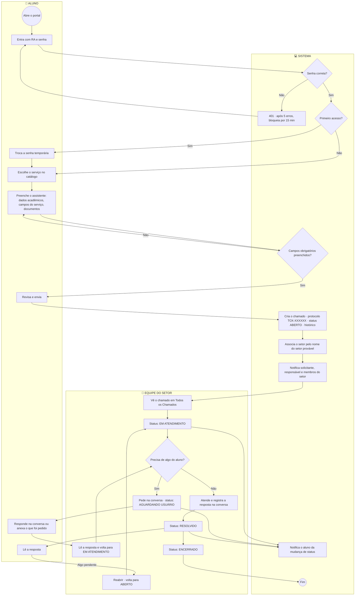
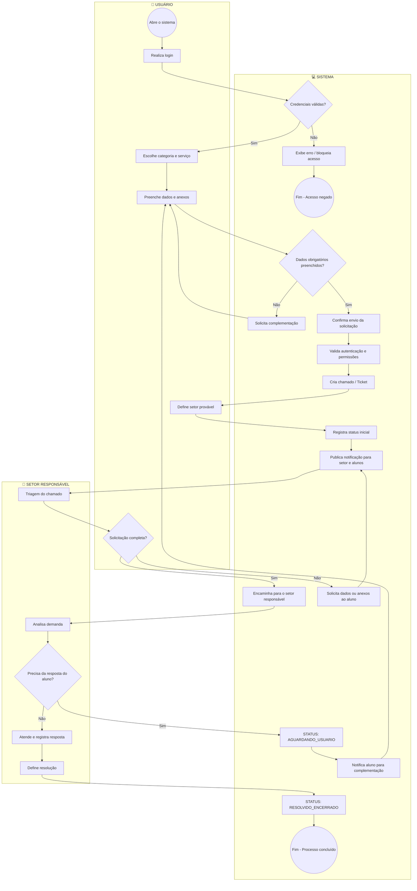

# Fluxo de Abertura e Atendimento de Chamados

Este é o processo **como o sistema funciona hoje** (conferido com o código de `develop` em outubro de 2026), organizado em três raias: **Aluno**, **Sistema** e **Equipe do setor**. A versão original, de planejamento, está no [fim da página](#versão-original-planejamento).

## Diagrama

## Etapas por raia

### 👤 Aluno

| Etapa | Descrição |
|---|---|
| Entra com RA e senha | Aba **Aluno (RA)** da tela de login |
| Troca a senha temporária | Só no primeiro acesso: a API responde `428` e o portal abre a tela de primeiro acesso |
| Escolhe o serviço no catálogo | Por categoria ou busca; "Não encontrei o que preciso" abre uma solicitação geral |
| Preenche o assistente | 5 etapas: serviço, dados acadêmicos, campos específicos, documentos, revisão |
| Revisa e envia | O chamado só é criado neste momento |
| Responde na conversa | Complementação pelo **chat** e por **novos anexos**, no mesmo chamado (não preenche o formulário de novo) |
| Lê a resposta | Na página da solicitação; o aviso chega pelo sino |

### 💻 Sistema

| Etapa | Descrição |
|---|---|
| Senha correta? | Errou: `401`. Após **5 erros seguidos**, a conta fica bloqueada por **15 minutos** (`423`) |
| Primeiro acesso? | Conta com senha temporária precisa trocá-la antes de entrar |
| Campos obrigatórios? | Validação do assistente antes de avançar |
| Cria o chamado | Protocolo, status **ABERTO** e primeiro registro no histórico de status |
| Associa o setor | Procura um setor cujo nome contenha o "setor provável" do serviço; sem correspondência, o chamado fica **sem setor** ([backend#114](https://github.com/4dsm2026/backend_fatecProjeto/issues/114)) |
| Notifica | Notificação in-app (sino) para solicitante, responsável e membros do setor. **Não envia e-mail** ([backend#116](https://github.com/4dsm2026/backend_fatecProjeto/issues/116)) |
| Notifica mudança de status | A cada mudança, o aluno (e o responsável) recebem aviso; em **EM ATENDIMENTO**, também o setor |

### 🏢 Equipe do setor

| Etapa | Descrição |
|---|---|
| Vê o chamado | Lista **Todos os Chamados** (ou Kanban), com filtros |
| EM ATENDIMENTO | Alguém começou a atender |
| Precisa de algo do aluno? | Se sim, pede na conversa e muda para **AGUARDANDO USUÁRIO** |
| Lê a resposta | Quando o aluno responde, o status **não volta sozinho**: a equipe muda para EM ATENDIMENTO ([backend#117](https://github.com/4dsm2026/backend_fatecProjeto/issues/117)) |
| RESOLVIDO / ENCERRADO | Resolvido: pedido atendido. Encerrado: nada mais a fazer. A diferença entre os dois ainda será definida ([backend#119](https://github.com/4dsm2026/backend_fatecProjeto/issues/119)) |
| Reabrir | Volta o chamado para ABERTO |

## Previsto, mas ainda não implementado

| Etapa prevista | Issue |
|---|---|
| Encaminhar o chamado para outro setor | [frontend#251](https://github.com/4dsm2026/frontend_fatecProjeto/issues/251) |
| Triagem pela Secretaria antes do setor | Hoje o chamado vai direto ao setor provável |
| Prazo (SLA) por serviço | [backend#115](https://github.com/4dsm2026/backend_fatecProjeto/issues/115) |
| E-mails nos eventos do chamado | [backend#116](https://github.com/4dsm2026/backend_fatecProjeto/issues/116) |
| Registrar o resultado (deferido/indeferido) | [backend#123](https://github.com/4dsm2026/backend_fatecProjeto/issues/123) |
| Regras de transição entre status | [backend#119](https://github.com/4dsm2026/backend_fatecProjeto/issues/119) |

## Versão original (planejamento)

Diagrama BPMN de planejamento (`BPMN_Projet.drawio`, setembro de 2026), mantido como registro. As diferenças para o sistema atual estão em [docs#11](https://github.com/4dsm2026/docs_fatecProjeto/issues/11).

Ver o diagrama original

