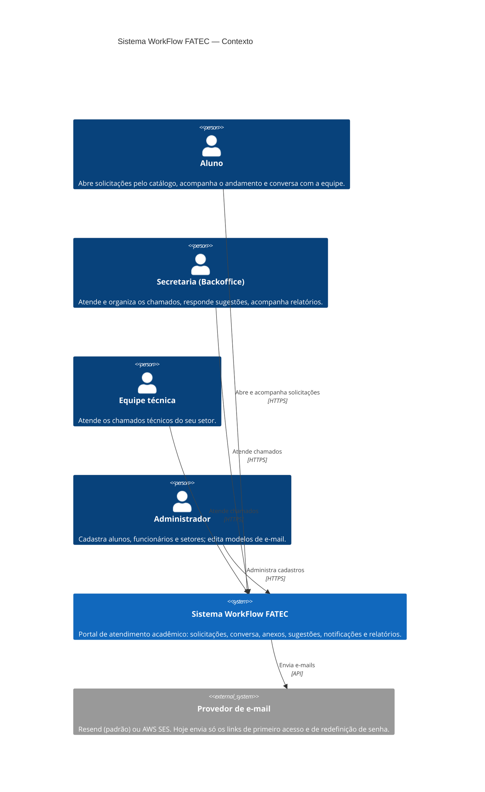

# Diagrama de Contexto — Sistema WorkFlow FATEC

Atualizado em outubro de 2026 a partir do código de `develop`. A explicação de cada elemento está em [Documentação dos Diagramas C4](./Explicando_Diagrama_C4.md).
