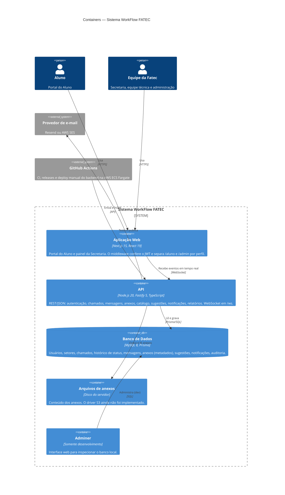

# Diagrama de Containers — Sistema WorkFlow FATEC

:::warning Anexos em produção
O deploy na AWS ECS Fargate usa `STORAGE_DRIVER=s3`, mas a API grava os anexos sempre no disco do container, que é apagado a cada novo deploy ou reinício. [backend#121](https://github.com/4dsm2026/backend_fatecProjeto/issues/121).
:::

Explicação de cada container em [Documentação dos Diagramas C4](./Explicando_Diagrama_C4.md#2-diagrama-de-container).
