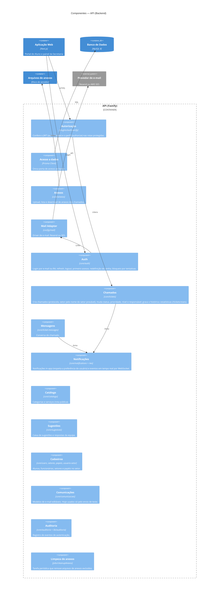

# Diagrama de Componentes — API (Backend)

Cada componente corresponde a um módulo em `src/core/<módulo>/` (rotas → controller → service) ou a um plugin/biblioteca do backend.

Para o diagrama ficar legível, ele mostra só as ligações principais. As demais:

- todos os módulos acessam o banco pelo **Acesso a dados**, e todas as rotas protegidas passam pela **Autorização**;
- **Mensagens** e **Anexos** também avisam pelas **Notificações**; as mensagens vão em tempo real só para os participantes do chamado;
- **Auth** registra os logins na **Auditoria**; **Comunicações** usa o **Mail Adapter** só no envio de teste;
- a **Limpeza de anexos** remove do disco os arquivos de anexos excluídos.

## O que ainda não existe

| Descrito antes | Situação | Issue |
|---|---|---|
| Chamados "controla transições de status" | Qualquer status pode ir para qualquer outro | [backend#119](https://github.com/4dsm2026/backend_fatecProjeto/issues/119) |
| Chamados "valida categoria/serviço" no catálogo | Não valida | [backend#120](https://github.com/4dsm2026/backend_fatecProjeto/issues/120) |
| Comunicações enviando os e-mails dos eventos | Modelos não são usados nos envios | [backend#116](https://github.com/4dsm2026/backend_fatecProjeto/issues/116) |
| Anexos no S3 | Só disco local | [backend#121](https://github.com/4dsm2026/backend_fatecProjeto/issues/121) |
