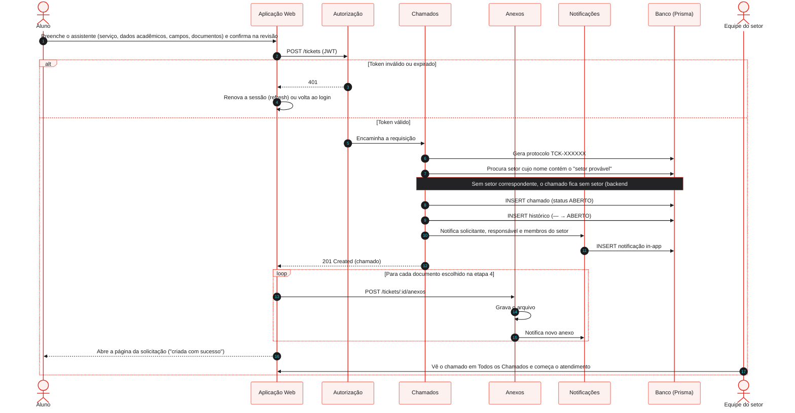

# Diagrama Dinâmico — Abertura de Chamado

Como os componentes colaboram quando o aluno envia uma solicitação pelo assistente do catálogo.

Diferenças em relação à versão original deste diagrama:

- O serviço do catálogo **não é validado** na criação (não há resposta 422) — [backend#120](https://github.com/4dsm2026/backend_fatecProjeto/issues/120).
- Os anexos são enviados **depois** que o chamado é criado, um por requisição.
- O sistema grava o **histórico de status** já na abertura.
- A equipe só é notificada se o chamado tiver setor (ou responsável).
