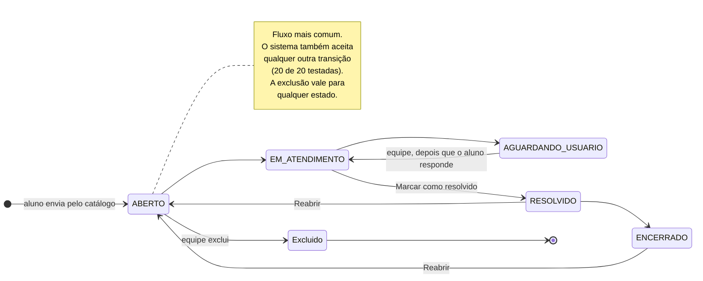
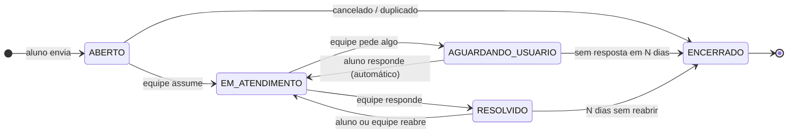

# Ciclo de vida do chamado

Esta página descreve os **estados** de um chamado (solicitação) e as **transições** entre eles, como o sistema funciona hoje. O comportamento foi conferido em 20/10/2026, testando todas as transições pela API no ambiente local a partir de `develop`. No fim, há uma [proposta](#proposta-para-discussão) para a decisão sobre os status oficiais ([backend#119](https://github.com/4dsm2026/backend_fatecProjeto/issues/119)).

## Estados

| Estado (código) | Campo **Status** da equipe | Selo nas listas | Filtro do aluno | Significado |
|---|---|---|---|---|
| `ABERTO` | Aberto | Solicitação recebida pela Fatec. | Recebida pela Fatec | Recebido, ainda não iniciado |
| `EM_ATENDIMENTO` | Em atendimento | Em análise pelo setor responsável. | Em análise | Alguém da equipe está cuidando |
| `AGUARDANDO_USUARIO` | Aguardando usuário | Aguardando documento ou resposta do aluno. | Aguardando minha ação | Falta algo do aluno |
| `RESOLVIDO` | Resolvido | Solicitação respondida. | Respondida | O pedido foi atendido |
| `ENCERRADO` | Encerrado | Atendimento finalizado. | Encerrada | Nada mais a fazer |

Além desses, um chamado pode ser **excluído** pela equipe: ele some das listas e das buscas, mas continua no banco com a data de exclusão (`deletadoEm`) e um registro na auditoria.

## Como funciona hoje

O diagrama mostra o caminho mais usado. **Não há regras de transição**: na tela do chamado, o campo **Status** oferece os cinco estados a qualquer momento, e os botões **Marcar como resolvido** e **Reabrir** ficam sempre disponíveis, mesmo quando não fazem sentido (por exemplo, Reabrir em um chamado já Aberto).

### Quem muda o estado

| Ação | Quem | Onde |
|---|---|---|
| Criar o chamado (→ Aberto) | Aluno | Assistente do catálogo |
| Mudar o status | Equipe (Backoffice, Técnico, Administrador) | Atribuição & Status, no detalhe do chamado |
| Reabrir / Marcar como resolvido | Equipe | Botões no detalhe do chamado |
| Excluir | Equipe | API (`DELETE /tickets/:id`) |

O aluno **não** muda o estado. Responder na conversa ou anexar arquivos **não altera o status**, nem quando o chamado está em Aguardando usuário ([backend#117](https://github.com/4dsm2026/backend_fatecProjeto/issues/117)).

### O que acontece em cada transição

| Efeito | Comportamento |
|---|---|
| Histórico | Toda mudança de status grava uma linha no **histórico de status** (de, para, quem e quando). Salvar o mesmo status não grava nada |
| Notificação | O **aluno** e o **responsável** recebem aviso (in-app) a cada mudança. Em **Em atendimento**, os **membros do setor** também |
| E-mail | Nenhum: os modelos de Comunicações ainda não são usados ([backend#116](https://github.com/4dsm2026/backend_fatecProjeto/issues/116)) |
| Data de encerramento | Preenchida ao ir para Resolvido ou Encerrado. **Não é limpa ao reabrir** ([backend#127](https://github.com/4dsm2026/backend_fatecProjeto/issues/127)) |
| Prazo (SLA) | Não é definido nem alterado pelas transições ([backend#115](https://github.com/4dsm2026/backend_fatecProjeto/issues/115)) |

## Validação (20/10/2026)

As 20 transições possíveis entre os 5 estados foram executadas pela API, com um chamado de teste no ambiente local:

| Verificação | Resultado |
|---|---|
| Transições aceitas | 20 de 20, todas com HTTP 200 (inclusive Encerrado → Aberto e Aberto → Resolvido) |
| Histórico | 1 linha por transição ✅; nenhuma ao salvar o mesmo status ✅ |
| Notificação ao aluno | 1 por transição ✅ |
| Data de encerramento | Preenchida em Resolvido/Encerrado ✅; continua preenchida depois de reabrir ❌ |
| Exclusão | Chamado some (404 depois de excluído) ✅ |

Pontos em aberto: regras de transição e nomes oficiais ([backend#119](https://github.com/4dsm2026/backend_fatecProjeto/issues/119)), retorno automático quando o aluno responde ([backend#117](https://github.com/4dsm2026/backend_fatecProjeto/issues/117)) e a data de encerramento ([backend#127](https://github.com/4dsm2026/backend_fatecProjeto/issues/127)).

## Proposta para discussão

:::caution Ainda não implementado
Este é um **ponto de partida** para a decisão de [backend#119](https://github.com/4dsm2026/backend_fatecProjeto/issues/119), a ser validado com a secretaria. O sistema hoje funciona como descrito acima.
:::

O que a proposta muda:

1. **Só transições permitidas.** A API recusa as outras (ex.: Encerrado → Aberto), e a tela só mostra as opções válidas para o estado atual.
2. **Retorno automático:** quando o aluno responde em Aguardando usuário, o chamado volta para Em atendimento ([backend#117](https://github.com/4dsm2026/backend_fatecProjeto/issues/117)).
3. **Resolvido ≠ Encerrado:** Resolvido pode ser reaberto; Encerrado é final. Encerrar automaticamente depois de N dias (a definir) sem reabertura ou sem resposta do aluno.
4. **Reabrir volta para Em atendimento**, não para Aberto, e limpa a data de encerramento.
5. **Resultado registrado** ao resolver (deferido, indeferido…) ([backend#123](https://github.com/4dsm2026/backend_fatecProjeto/issues/123)).

Para decidir: o valor de N dias; se o aluno pode cancelar o próprio chamado enquanto estiver Aberto; se o aluno pode reabrir um chamado Resolvido.
